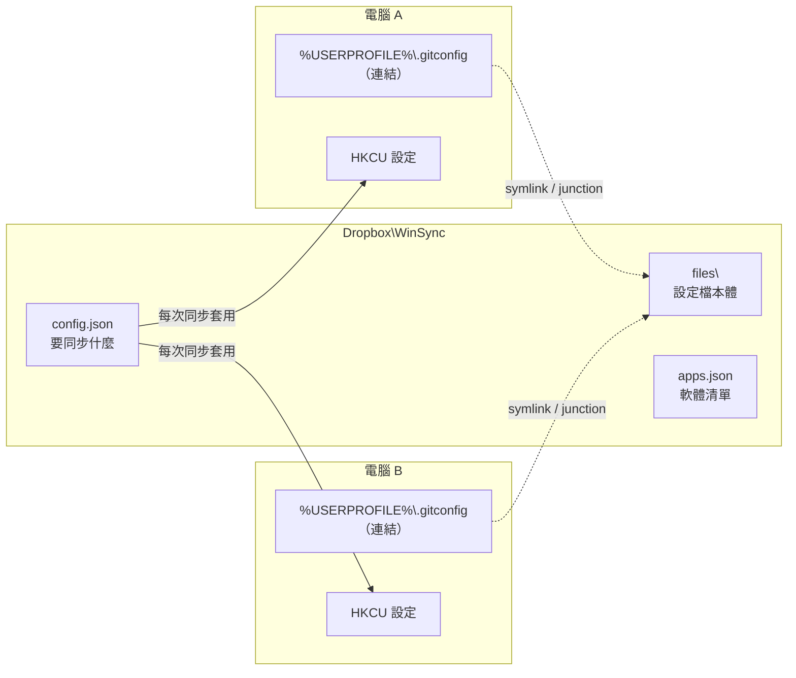

# win-sync

用 Dropbox 同步多台 Windows 電腦的 Windows 設定、App 設定檔、Documents 與軟體清單，可以想成 Windows 版的 [Mackup](https://github.com/lra/mackup) 加強版。

- 新電腦只要跑一次 `win-sync init`，之後每次登入都會自動同步。
- 需要你動手的事（登入 Dropbox、登出生效、處理衝突等），會在最後列成待辦清單，並寫明步驟。
- 純 PowerShell 腳本，相容 Windows PowerShell 5.1，不需要安裝其他東西。

## 運作方式



| 同步項目 | 做法 |
|---|---|
| App 設定檔／資料夾 | 本體搬進 `Dropbox\WinSync\files\`，原位置換成連結。資料夾用 junction，檔案用 symlink。Dropbox 即時同步，兩台電腦讀寫的是同一份。 |
| Windows 設定 | `config.json` 列出 registry 值，每次同步都套用到本機（宣告式、單向）。 |
| Documents | 把「文件」資料夾的位置改指向 Dropbox 裡的資料夾。 |
| 軟體 | `apps.json` 是 `winget export` 的格式，缺少的軟體用 `winget import` 安裝。 |

工具（本 repo）和資料（`Dropbox\WinSync`）是分開的：工具用 git 管理，資料靠 Dropbox 同步，不進 git。

## 安裝

建議把工具放在固定位置，例如 `%USERPROFILE%\win-sync`。init 會把這個位置寫進登入排程和 PATH，之後搬動的話要重新執行 `win-sync init`。

```powershell
winget install -e --id Git.Git      # 若還沒有 git
git clone https://github.com/zoosewu/win-sync.git "$env:USERPROFILE\win-sync"
& "$env:USERPROFILE\win-sync\win-sync.cmd" init
```

沒有 git 的話，也可以在 GitHub 下載 zip 解壓縮，再執行裡面的 `win-sync.cmd init`。

init 會跳出 UAC 要求系統管理員權限（用來開啟開發人員模式與註冊排程）。完成後重新開啟終端機，就能在任何位置直接輸入 `win-sync`。

## 使用情境

### 第一台電腦

1. 安裝並登入 Dropbox（init 也會詢問要不要用 winget 代為安裝）。
2. 執行 `win-sync init`，被問到「這是第一台使用 win-sync 的電腦嗎？」時回答 `y`。
3. init 會：
   - 依 `templates/` 建立 `Dropbox\WinSync`。範本裡的 Windows 設定會改成記錄**這台電腦目前的值**，所以這台不會被改動。
   - 詢問要不要把 Documents 改放到 `Dropbox\Documents`（已經在 Dropbox 內就不會問）。
   - 詢問要不要把目前安裝的軟體匯出成 `apps.json`。
   - 把 `config.json` 列出的設定檔搬進 Dropbox 並換成連結。
4. 之後用 `win-sync add`、`win-sync add-reg` 加入更多要同步的東西。

### 新電腦

1. 安裝並登入 Dropbox，**等 `WinSync` 資料夾同步下來**。有用「選擇性同步」的話，記得勾選它。
2. 安裝工具，執行 `win-sync init`。
3. init 會套用所有 Windows 設定、建立連結、詢問要不要安裝缺少的軟體。
4. 依最後的待辦清單完成剩下的事（通常是登出再登入）。

### 已經在用的電腦

和新電腦一樣執行 `win-sync init`。本機和 Dropbox 都有同一份設定檔時：

- 內容相同：直接換成連結。
- 內容不同：init 會問你要用哪一版。沒選的那一版會備份成 `<原檔名>.win-sync-bak-<時間>`，確認不需要後再刪除。
- 背景同步時不會詢問，一律用 Dropbox 版本，本機版備份。

## 指令

| 指令 | 說明 |
|---|---|
| `win-sync init` | 新電腦或第一次使用：檢查／安裝 Dropbox、開啟開發人員模式、設定登入自動同步、加入 PATH、套用所有設定、安裝軟體。需要系統管理員。 |
| `win-sync status` | 檢查狀態並列出需要處理的事，**不做任何修改**。也會顯示上次背景同步留下的待辦。 |
| `win-sync sync` | 立即同步。每次登入 2 分鐘後也會自動在背景執行。 |
| `win-sync add <路徑> [名稱]` | 把 App 設定檔或資料夾加入同步，並立刻連結。例如 `win-sync add "%APPDATA%\Code\User\keybindings.json"`。 |
| `win-sync add-reg <機碼> <值名稱> [說明]` | 把這台電腦目前的某個 registry 值加入同步。機碼可以直接從登錄編輯程式的網址列複製。 |
| `win-sync apps` | 安裝 `apps.json` 裡尚未安裝的軟體。 |
| `win-sync export-apps` | 把這台電腦已安裝的軟體併入 `apps.json`。 |
| `win-sync help` | 顯示說明。 |

背景同步有待辦時，會跳出 Windows 通知，請執行 `win-sync status` 查看步驟。執行紀錄在 `%LOCALAPPDATA%\win-sync\win-sync.log`。

## config.json 格式

位置在 `Dropbox\WinSync\config.json`，可以直接編輯，也可以用 `add`、`add-reg` 指令修改。

```json
{
  "documents": "Documents",
  "links": [
    { "name": "gitconfig", "path": "%USERPROFILE%\\.gitconfig" }
  ],
  "registry": [
    {
      "label": "顯示副檔名",
      "key": "HKCU:\\Software\\Microsoft\\Windows\\CurrentVersion\\Explorer\\Advanced",
      "name": "HideFileExt",
      "value": 0,
      "type": "DWord"
    }
  ]
}
```

| 欄位 | 說明 |
|---|---|
| `documents` | Documents 要放在 Dropbox 裡的哪個資料夾（相對於 Dropbox 根目錄，也可以是絕對路徑）。`null` 表示不處理 Documents。 |
| `links[].name` | 在 `files\` 底下的名稱，不能重複。 |
| `links[].path` | 本機位置，可使用 `%USERPROFILE%`、`%APPDATA%`、`%LOCALAPPDATA%` 等環境變數，讓不同使用者名稱的電腦都能用。 |
| `registry[].label` | 顯示用的說明，可省略。 |
| `registry[].key` | `HKCU:\...` 或 `HKLM:\...`。 |
| `registry[].type` | `DWord`、`QWord`、`String`、`ExpandString`、`MultiString`、`Binary`。 |

## 限制

- **Windows 設定是單向的**：在「設定」App 裡改的東西不會自動回寫到 `config.json`，要用 `win-sync add-reg` 記錄。反過來說，`config.json` 列出的值每次同步都會被套用，在本機改了也會被蓋回去。
- **同一個 App 不要在兩台電腦同時開著**，否則 Dropbox 可能產生衝突複本（conflicted copy）。`status` 會偵測並提示怎麼處理。
- **有些 App 存檔時會「寫暫存檔再改名」**，把連結換成一般檔案。下次同步時會把它備份成 `.win-sync-bak-*` 並重新連結，請確認備份內容後再刪除。
- **不要同步快取、資料庫、私鑰**。有內建同步功能的 App（VS Code、瀏覽器等），用它自己的同步。
- **HKLM 底下的設定需要系統管理員**。背景同步沒有權限，會失敗並產生待辦，請以系統管理員執行 `win-sync sync`。
- **檔案連結需要開發人員模式**（init 會開啟）。沒開的話，資料夾仍可同步，檔案會失敗並產生待辦。

## FAQ

**需要另外開一個 repo 放我的設定嗎（像 dotfiles 那樣）？**
不需要。設定資料放在 `Dropbox\WinSync`，靠 Dropbox 即時同步，而且裡面是個人資料，不應該進 git。這個 repo 只放工具本身。

**為什麼用連結，而不是定時複製？**
連結讓每台電腦讀寫的都是 Dropbox 裡的同一份檔案，改了馬上同步，不需要決定「哪邊比較新」。

**怎麼停止同步某個設定檔？**
目前要手動處理：從 `config.json` 的 `links` 移除該項目，刪除本機的連結，再把 `Dropbox\WinSync\files\<名稱>` 複製回原位置。

**init 會改我的電腦哪些東西？**
開發人員模式、名為 `win-sync` 的排程工作、使用者 PATH、Documents 位置（若有選擇），以及 `config.json` 列出的設定檔與 registry 值。

## 開發

```powershell
powershell -NoProfile -ExecutionPolicy Bypass -File tests\smoke.ps1
```

冒煙測試用環境變數 `WINSYNC_DATA` 指向暫存資料夾，不會碰到真正的 Dropbox、Documents 或排程。開發慣例見 [CLAUDE.md](CLAUDE.md)。
